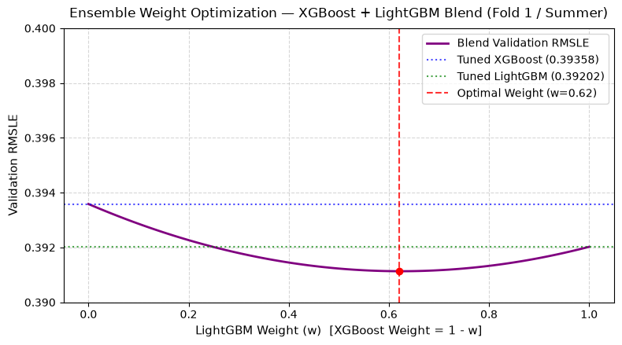
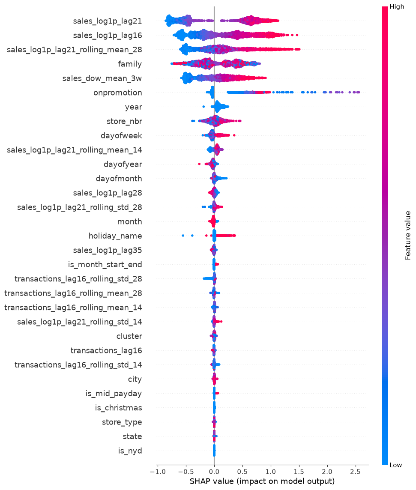

# Store Sales - Time Series Forecasting

[](https://github.com/izisopou/store-sales-forecasting/actions/workflows/ci.yaml)

Predicting daily unit sales across 54 grocery stores and 33 product families for Kaggle's [Store Sales - Time Series Forecasting competition](https://www.kaggle.com/competitions/store-sales-time-series-forecasting/overview).

This repository implements a production-grade demand forecasting pipeline using Google BigQuery and SQL for warehouse-level data extraction, Pandas for time-series feature engineering, and gradient boosted trees (XGBoost / LightGBM) for multi-step forecasting across a 16-day horizon.

> **Note on Model Scope:** This pipeline is specifically designed for short-term forecasting (16 days). For long-term forecasting (>6 months), a hybrid architecture is recommended (e.g., a linear or polynomial regressor to capture macro trends combined with a gradient boosting model trained on residuals).


## Table of Contents

1. [Environment Setup](#environment-setup)
2. [Docker Environment Setup](#docker-environment-setup)
3. [Data Ingestion & Storage (BigQuery to Parquet)](#data-ingestion--storage-bigquery-to-parquet)
4. [Feature Engineering Pipeline](#feature-engineering-pipeline)
5. [Model Training & Validation Pipeline](#model-training--validation-pipeline)
6. [Model Inference Pipeline](#model-inference-pipeline)
7. [End-to-End Pipeline Orchestration](#end-to-end-pipeline-orchestration)
8. [Empirical Analysis, Experimental Studies & Future Roadmap (v1.1.0)](#empirical-analysis-experimental-studies--future-roadmap-v110)
9. [Repository Structure](#repository-structure)


## Environment Setup

```bash
# Clone repository
git clone git@github.com:izisopou/store-sales-forecasting.git
cd store-sales-forecasting

# Create and activate virtual environment
python -m venv .venv
source .venv/bin/activate  # On Windows: .venv\Scripts\activate

# Install dependencies
pip install -r requirements.txt
```

## Docker Environment Setup

As an alternative to a local virtual environment, the complete ingestion and training pipeline can be run inside an isolated container.

### 1. Host Machine Prerequisites
If you are deploying on a fresh Ubuntu workspace, install the Docker engine and the Buildx CLI component:
```bash
sudo apt-get update && sudo apt-get install -y docker.io docker-buildx
sudo usermod -aG docker $USER
newgrp docker
```
*Note: To apply group permissions permanently across future sessions without typing `newgrp docker`, log out of your system user session and log back in.*

Ensure BuildKit is exported as your active runtime compiler engine:
```bash
echo "export DOCKER_BUILDKIT=1" >> ~/.bashrc && source ~/.bashrc
```

### 2. Build the Production Image
Compile the container image from the project root. This only needs to be run once unless dependencies or python scripts change:
```bash
docker build -t store-sales-forecasting:latest .
```

### 3. Pipeline Container Execution
Run the end-to-end forecasting pipeline. The `-it` flags run the container interactively, allowing you to stop the pipeline instantly using `Ctrl+C`.

```bash
# Option A: Run from local interim Parquet files (features -> train -> predict)
docker run --rm -it \
  -v "$(pwd)/data:/app/data" \
  -v "$(pwd)/models:/app/models" \
  store-sales-forecasting:latest \
  --steps features train predict --output-name submission_docker.csv

# Option B: Run full end-to-end pipeline including BigQuery extraction (requires .env and gcloud auth)
docker run --rm -it \
  --env-file .env \
  -v "$HOME/.config/gcloud:/root/.config/gcloud" \
  -v "$(pwd)/data:/app/data" \
  -v "$(pwd)/models:/app/models" \
  store-sales-forecasting:latest \
  --steps extract features train predict --output-name submission_docker.csv
```

## Data Ingestion & Storage (BigQuery to Parquet)

The original competition data is provided by Kaggle as separate CSV files. To simulate a cloud data warehouse workflow, these tables were loaded into Google BigQuery under `store-sales-project.store_sales`.

While the competition tables are MB-scale and can technically fit in memory, heavy relational joins and filtering are delegated directly to BigQuery. This approach replicates a production-grade data warehouse pipeline and avoids repetitive, memory-heavy joins locally.

1. **BigQuery SQL Extraction:** 
   * Base tables (`train`, `test`, `stores`, `oil`, `holidays_events`) are merged and filtered directly in BigQuery using `sql/extract_base.sql`.

   * Workdays marked as holidays and duplicate event dates are filtered out in SQL to avoid row inflation.
   
   * `transactions` is extracted as a standalone table (`sql/extract_transactions.sql`) because store transactions are unavailable during the 16-day forecasting (test) window. Keeping it separate prevents accidental future data leakage and allows us to build safe lag features later.

2. **Local Parquet Storage:** 
   * Extracted data is saved locally in `data/interim/` as compressed `.parquet` files. Parquet preserves data types automatically and loads much faster than CSVs.

### Run Extraction

Ensure your Google Cloud credentials are authenticated, then execute:

```bash
# Extract all three tables (train, test, transactions) by default:
python src/extract_data.py

# Dry-run to estimate scanned bytes without incurring GCP billing:
python src/extract_data.py --dry-run

# Extract specific targets with a custom billing cap:
python src/extract_data.py --targets train test --max-gb-billed 0.5
```

* **Source:** BigQuery dataset `store-sales-project.store_sales`
* **SQL Queries:** `sql/extract_base.sql` & `sql/extract_transactions.sql`
* **Outputs:** `train.parquet`, `test.parquet`, and `transactions.parquet` saved in `data/interim/`
* **Reference Notebook:** `notebooks/01_raw_data_inspection.ipynb`

## Feature Engineering Pipeline

The feature engineering stage processes interim tables into finalized feature matrices for model training and inference. To ensure reproducible, leak-free predictions across the 16-day test window, lags and rolling stats are computed on a continuous daily timeline across train and test sets to prevent data leakage and gaps.

1. **Calendar Completeness & Grid Validation:**
   * Validates that all 54 stores and 33 product families ($1,782$ series) are present on every recorded date.

   * Automatically detects closure dates (e.g., Christmas Day, Dec 25) missing from historical records and imputes them with zero sales so that day-based lags stay aligned with row shifts.

2. **Leak-Free Lag & Rolling Dynamics:**
   * Since predictions cover a 16-day horizon, target lags are strictly constrained to $\geq16$ days. Multiples of 7 (`lag21`, `lag28`, `lag35`) align with the exact day-of-week 3, 4, and 5 weeks prior.

   * Smoothed Weekday Baseline: `sales_dow_mean_3w` averages the last three aligned weekdays to capture a stable same-weekday baseline less sensitive to single-day spikes.

   * Local Statistics: 14-day and 28-day rolling means and standard deviations over `sales_log1p_lag21` to capture short-term demand levels and volatility. 

   * Store Footfall: Store-level 16-day lagged transactions along with 14-day and 28-day rolling metrics to track store traffic trends without leakage.

3. **Promotions:**
   * Uses raw daily item promotion counts (`onpromotion`). Since promotion schedules are known in advance, they serve as a strong and direct forward-looking feature for the entire test window.

4. **Calendar & Payday Signals:**
   * Calendar indicators (`dayofweek`, `dayofmonth`, `dayofyear`, `month`, `year`) capture Ecuadorian retail patterns like weekend volume spikes (+20% to +30%).

   * Binary flags for known store closures (`is_christmas`, `is_nyd`) and Ecuadorian paydays on the 15th and month-end (`is_mid_payday`, `is_month_start_end`).

5. **Warm-Up Trimming & Memory Optimization:**
   * The first two months (`2013-01-01` to `2013-02-28`) are used to warm up 35-day lags and rolling windows, and are dropped from training (`warmup_cutoff = 2013-03-01`).

   * High-cardinality columns (`store_nbr`, `family`, `city`, `state`, `store_type`, `cluster`, `holiday_name`) are cast to `category` on the combined dataset so category codes remain consistent across train and test.

### Excluded Features

* **`oil_price`:** Daily crude oil prices added noise without improving validation performance. Excluding raw oil prices yielded a lower (better) validation RMSLE.

* **`is_holiday` & `is_earthquake_period`:** Both indicators were dropped after ablation tests showed they were redundant, as their information is already fully captured and better split by the `holiday_name` categorical feature.

### Run Feature Engineering     

```bash
# Build features using default directories (data/interim -> data/processed):
python src/build_features.py

# Build features into a custom directory or specify a custom warm-up cutoff:
python src/build_features.py --output-dir data/processed --warmup-cutoff 2013-03-01
```

* **Inputs:** `train.parquet`, `test.parquet`, and `transactions.parquet` from `data/interim/`
* **Outputs:** `train_features.parquet` (35 columns) and `test_features.parquet` (33 columns) saved in `data/processed/`
* **Reference Notebook:** `notebooks/02_eda_fe.ipynb`


## Model Training & Validation Pipeline

Instead of training 1,782 isolated local models (which introduces severe maintenance problems and vulnerabilities in production) or relying on recursive 1-step-ahead loops (which suffer from exponential error accumulation across a 16-day horizon), this pipeline implements a **Global Direct-Horizon Gradient Boosted Decision Tree (GBDT) Ensemble** combining **XGBoost (38% weight)** and **LightGBM (62% weight)**.

1. **RMSLE Alignment via Log-Space Optimization:**
   * Models are trained on the log-transformed target `sales_log1p` = $\ln(1 + \text{sales})$ using Root Mean Squared Error (`rmse`) as the objective and evaluation metric. Optimizing RMSE in $\ln(1 + y)$ space is mathematically equivalent to optimizing RMSLE on raw unit sales.

2. **Chronological Out-of-Time Validation & Dynamic `n_estimators`:**
   * By default, `src/train.py` splits the dataset chronologically, holding out the final 16 days (`2017-07-31` to `2017-08-15`, $28,512$ rows) as an out-of-time validation set that mirrors the exact length of the test horizon.

   * During validation, models train with early stopping (`early_stopping_rounds = 50`, cap of $2,500$ trees) to dynamically identify the optimal number of trees (`best_iter`) for the active training distribution.

   * When `--full-train` is enabled, the pipeline automatically transfers the validated `best_iter` to refit the production models on 100% of the training data, preventing overfitting when experimenting with shorter historical windows (`--warmup-cutoff`). If a custom historical backtest window is specified via `--val-start-date`, the script automatically runs a reference validation pass on the latest 16-day holdout window before full training.

3. **Domain-Driven Post-Processing (`--apply-holiday-rules`):**
   * Tree-based models trained on high pre-holiday sales lags tend to over-predict sales on major national closures.

   * When enabled, the post-processing layer inspects historical sales on **Christmas Day (Dec 25)** and **New Year's Day (Jan 1)**, setting predictions to zero for stores that have historically recorded zero sales on those dates (54 stores on Dec 25; 52 stores on Jan 1).

4. **Artifact & Metadata Contracts:**
   * Serialized production models (`xgb_model.joblib`, `lgbm_model.joblib`) are saved alongside `model_metadata.json`, which records the training timestamp, validation metrics, ensemble weights, exact feature schema (31 columns), and locked hyperparameters.

### Run Model Training

```bash
# Run validation on the default 16-day holdout window (without saving full models):
python src/train.py

# Backtest on a historical holiday window and evaluate post-processing rules:
python src/train.py --val-start-date 2016-12-19 --val-days 16 --apply-holiday-rules

# Run validation, train final production models on 100% of data, and save artifacts:
python src/train.py --full-train --apply-holiday-rules
```

* **Inputs:** `train_features.parquet` from `data/processed/`
* **Outputs:** `xgb_model.joblib`, `lgbm_model.joblib`, and `model_metadata.json` saved in `models/`
* **Reference Notebook:** `notebooks/03_modeling.ipynb`

### Model Evaluation & Interpretability

1. **Ensemble Weight Optimization:**
   Evaluating the validation blend across weights shows a broad, shallow optimum: any weight between roughly 0.3 and 0.9 slightly outperforms both standalone models, reaching a minimum at 62% LightGBM / 38% XGBoost (`0.39113` vs `0.39202` for LightGBM and `0.39358` for XGBoost). While the numerical improvement over standalone LightGBM is marginal (~0.0009 RMSLE), ensembling acts as variance reduction against single-model errors.

<p align="center">
  
</p>

2. **Feature Importance (SHAP Analysis):**
   Tree SHAP values computed on the validation split confirm that predictions are predominantly driven by recent weekday-aligned lags (`sales_log1p_lag21`, `sales_dow_mean_3w`), the 16-day boundary lag (`sales_log1p_lag16`), 28-day rolling demand levels, product `family`, and active `onpromotion` counts:

<p align="center">
  
</p>

## Model Inference Pipeline

The inference script (`src/predict.py`) loads the trained model artifacts and generates unit sales predictions for the 16-day test window (`2017-08-16` to `2017-08-31`).

1. **Contract & Schema Validation:**
   * Reads `model_metadata.json` to enforce the exact feature list and ordering used during training, and verifies that the test horizon does not exceed the 16-day lag constraint (`MAX_FORECAST_HORIZON = 16`).

2. **Log-Space Blending & Inversion:**
   * Generates log-space predictions from each model, clips negative log predictions at `0.0`, blends them using the metadata ensemble weights ($0.38 \cdot \text{XGB} + 0.62 \cdot \text{LGBM}$), and maps predictions back to unit sales via `np.expm1`.

3. **Post-Processing & Sanity Checks:**
   * Optionally applies the historical holiday closure rules (`--apply-holiday-rules`) and validates that final predictions contain no `NaN` or infinite values before exporting the sorted `submission.csv`.

### Run Inference

```bash
# Generate standard ensemble predictions using saved models and metadata:
python src/predict.py --apply-holiday-rules

# Specify a custom output directory or filename:
python src/predict.py --output-dir data/predictions --output-name submission.csv --apply-holiday-rules
```

* **Inputs:** `test_features.parquet` and `train_features.parquet` from `data/processed/`, models & metadata from `models/`
* **Outputs:** `submission.csv` ($28,512$ predictions) saved in `data/predictions/`

## End-to-End Pipeline Orchestration

The root orchestrator (`main.py`) unifies all four pipeline stages (`extract` $\rightarrow$ `features` $\rightarrow$ `train` $\rightarrow$ `predict`) through a single CLI entry point.

* **Process & Memory Isolation:** Each stage is executed as an independent child process via `subprocess.run`. This guarantees that multi-gigabyte DataFrames allocated during feature engineering and gradient boosting are 100% reclaimed by the operating system before the next stage begins.

* **Directory Chaining & Experimentation:** Input and output directories are automatically chained across steps (`--interim-dir` $\rightarrow$ `--processed-dir` $\rightarrow$ `--models-dir` $\rightarrow$ `--predictions-dir`), enabling isolated experiments from a single command.

### Run End-to-End Pipeline

```bash
# 1. Execute the complete end-to-end pipeline (BigQuery extract -> features -> train -> predict):
python main.py

# 2. Skip BigQuery extraction and run from local interim parquet files:
python main.py --steps features train predict

# 3. Run an experiment with a custom training cutoff date:
python main.py --steps features train predict --warmup-cutoff 2015-06-01 --output-name sub_2015.csv

# 4. Run validation only on a historical holiday window:
python main.py --steps train --val-only --val-start-date 2016-12-19 --val-days 16
```

## Empirical Analysis, Experimental Studies & Future Roadmap (v1.1.0)

### 1. Impact of Deterministic Holiday Post-Processing
During the pre-Christmas and New Year shopping surge, recent sales lags are elevated. Without explicit closure rules, tree models predict high sales on December 25 and January 1, leading to large RMSLE penalties when actual sales are zero. Backtesting on the holiday window (`2016-12-19` to `2017-01-03`) demonstrates a **51.0% reduction in validation RMSLE**:

| Model / Stage (`2016-12-19` to `2017-01-03`) | Raw Validation RMSLE | With `--apply-holiday-rules` | Error Reduction |
| :--- | :---: | :---: | :---: |
| **XGBoost** | 0.95347 | 0.47733 | -49.9% |
| **LightGBM** | 1.02694 | 0.49962 | -51.3% |
| **Blended Ensemble (38% XGB / 62% LGBM)** | **0.99570** | **0.48739** | **-51.0%** |

### 2. Why Naive Zero-Sales Heuristics Fail (The Back-to-School Phenomenon)
An experimental post-processing rule was tested to zero out series whose historical sales were strictly zero over the preceding $N \in [60, 210]$ days. Across all lookback windows, this rule **degraded** validation RMSLE (from `0.39113` to `0.39661`).
* **Root-Cause Diagnostics:** Residual inspection revealed 28 validation series in the `SCHOOL AND OFFICE SUPPLIES` family that recorded exactly zero sales for 7 consecutive months (210+ days), then surged between August 9 and August 15 ahead of the September school start in Ecuador's Sierra region.

* **Takeaway:** The GBDT ensemble successfully combined `family` and calendar features (`month`, `dayofyear`, `onpromotion`) to capture the seasonal rebound despite all short-term lags (`lag16`–`lag35`) being zero. **Manual zeroing heuristics were therefore discarded.**

### 3. Historical Training Depth vs. Recency Ablation (`--warmup-cutoff`)
To test whether older historical data (`2013–2015`, prior to the April 2016 Ecuador earthquake) introduces regime-shift drag, the pipeline was evaluated across four training start dates using dynamic early-stopping tree counts:

| Training Start (`--warmup-cutoff`) | Full Train Rows | Validated Trees (XGB / LGBM) | Local Val RMSLE (Jul 31 – Aug 15) | Kaggle Public RMSLE (Aug 16 – Aug 31) |
| :--- | :---: | :---: | :---: | :---: |
| **`2013-03-01` (Full History)** | 2,902,878 | 891 / 1,133 | **0.39113** | **0.45088** |
| **2015-06-01** | 1,438,074 | 712 / 1,113 | 0.39163 | 0.45424 |
| **2016-06-01 (Post-Earthquake)** | 785,862 | 403 / 641 | 0.39658 | 0.48455 |
| **`2016-01-01` (Includes Earthquake)** | 1,056,726 | 740 / 1,032 | 0.39360 | 0.49299 |

* **Key Findings:** Truncating history to `2016` leaves the model with only a single historical August cycle (`Aug 2016`), severely degrading late-August test generalization (`0.48455`–`0.49299`). Furthermore, starting at `2016-01-01` performs worse than `2016-06-01` because the April–May 2016 earthquake relief spikes represent a disproportionately large fraction of the smaller dataset. Full historical depth (`2013-03-01`, capturing four complete August cycles) yields the strongest validation (`0.39113`) and test (`0.45088`) performance.

### 4. Validation-to-Test Regime Shift Analysis & Feature Roadmap (v1.1.0)
While the ensemble achieves **`0.39113` RMSLE** on the early-August validation window (`2017-07-31` to `2017-08-15`), performance shifts to **`0.45088` RMSLE** on the late-August test window (`2017-08-16` to `2017-08-31`). Root-cause analysis identified four structural feature limitations under a direct 16-day forecast horizon, defining the engineering roadmap for **v1.1.0**:

* **Rolling Aggregations & EWMA on `lag16` (`sales_log1p_lag16_rolling_mean_7/14`):**
  In v1.0, rolling sales statistics are computed on `sales_log1p_lag21` (`shift(21)`). For the test window (`Aug 16 – Aug 31`), `lag21` only sees data up to `Aug 10`, ignoring an average of **12.5 days** of recent mid-August data where Back-to-School demand accelerates. Meanwhile, raw `sales_log1p_lag16` suffers from day-of-week misalignment ($16 \pmod 7 = 2$, matching Sundays with Fridays). Adding 7-day and 14-day rolling means and exponentially weighted moving averages (EWMA) directly over `lag16` will eliminate weekday phase shift while capturing the most recent 5 days of known sales (`Aug 11 – Aug 15`).

* **Weekday-Aligned Annual Seasonal Lags (`sales_log1p_lag364` & `sales_log1p_lag364_rolling_mean_7`):**
  Ecuador's school calendar splits geographically (Sierra opens in September; Costa opens in May). Calendar features (`dayofyear`, `month`) indicate *when* a seasonal transition occurs, but cannot tell the tree the *store-specific volume scale* when short-term lags (`lag16`–`lag35`) are zero. Adding a 52-week lag (`shift(364)`, preserving exact day-of-week alignment with the prior year) will provide direct store-family scale during sharp annual regime shifts.

* **Promotional Context & Momentum Features (`onpromotion_lag16/21`, `onpromotion_rolling_mean_7`, `promo_diff`):**
  Currently, only the target date's `onpromotion` count is provided. Introducing lagged promotion counts (`onpromotion_lag16`, `onpromotion_lag21`), rolling promotional intensity (`7d`/`14d` means), and promotion deltas (`onpromotion` - `onpromotion_lag21`) will allow trees to distinguish organic baseline demand from promotion-driven spikes.

* **Hierarchical Target Aggregations (`state x family` and `store_nbr` Lagged Means):**
  Computing 7-day rolling means of `sales_log1p_lag16` grouped at the regional (`state`, `family`) and store (`store_nbr`) levels will capture macro regional trends (such as Sierra-wide Back-to-School surges) even for individual product series with sparse or noisy histories.

* **Macro Economic Signals (`oil_price` Momentum):**
  Replacing raw daily crude oil spot prices with 30-day rolling averages and month-over-month percentage changes to capture broader macroeconomic purchasing power without daily noise.

## Repository Structure

```text
store-sales-forecasting/
├── .github/workflows/        # CI/CD automation pipelines (GitHub Actions)
├── assets/                   # Plots and figures for documentation (SHAP, ensemble curves)
├── data/
│   ├── raw/                  # Original competition CSVs (untracked)
│   ├── interim/              # BigQuery extracted Parquet tables (train, test, transactions)
│   ├── processed/            # Engineered feature matrices (train_features, test_features)
│   └── predictions/          # Generated model submissions (submission.csv)
├── models/                   # Serialized trained models (.joblib) & model_metadata.json
├── notebooks/
│   ├── 01_raw_data_inspection.ipynb
│   ├── 02_eda_fe.ipynb
│   └── 03_modeling.ipynb
├── sql/
│   ├── extract_base.sql
│   └── extract_transactions.sql
├── src/
│   ├── extract_data.py       # Step 1: BigQuery to Parquet ingestion with billing caps
│   ├── build_features.py     # Step 2: Grid validation, closure imputation & feature engineering
│   ├── train.py              # Step 3: Out-of-time validation, dynamic refit & holiday rules
│   └── predict.py            # Step 4: Schema validation, ensemble blending & inference
├── .dockerignore             # Files excluded from the Docker build
├── .env.example              # Template for environment variables (GCP_PROJECT_ID)
├── .gitattributes            # Repository language overrides for GitHub Linguist
├── .gitignore                # Git ignore rules for data artifacts, models, and virtualenvs
├── Dockerfile                # Instructions for building the Docker image
├── README.md                 # Project documentation
├── main.py                   # End-to-end CLI pipeline orchestrator (subprocess isolated)
└── requirements.txt          # Python package dependencies
```